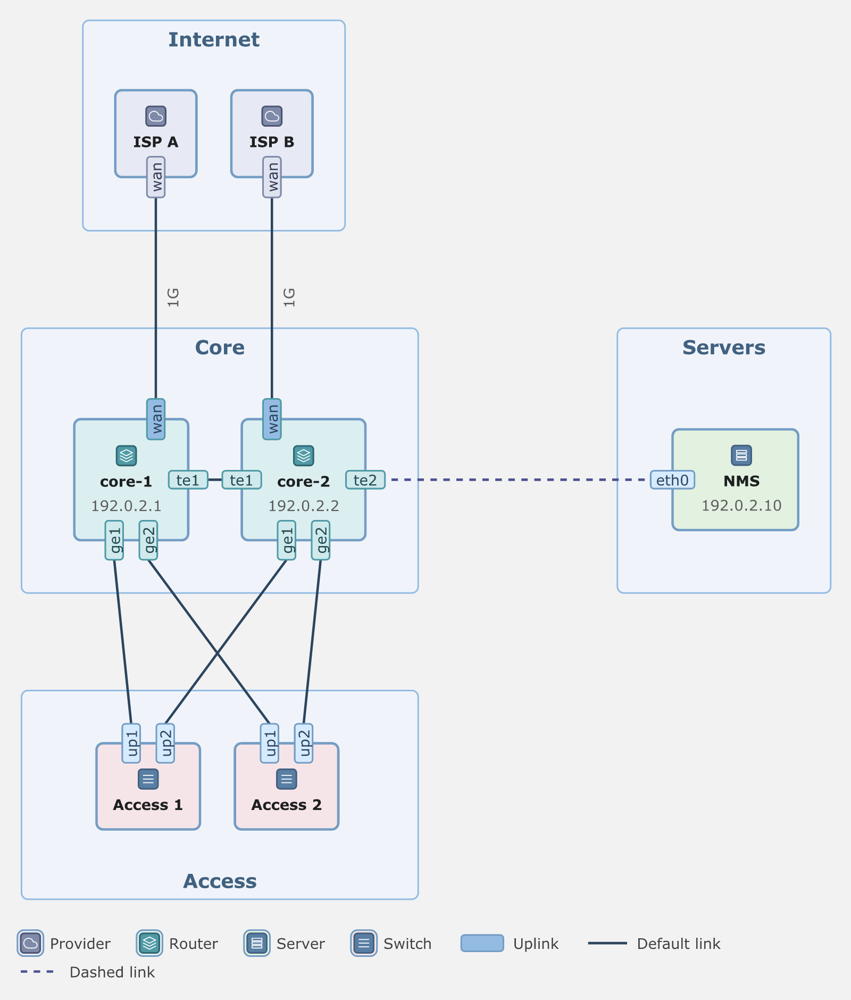
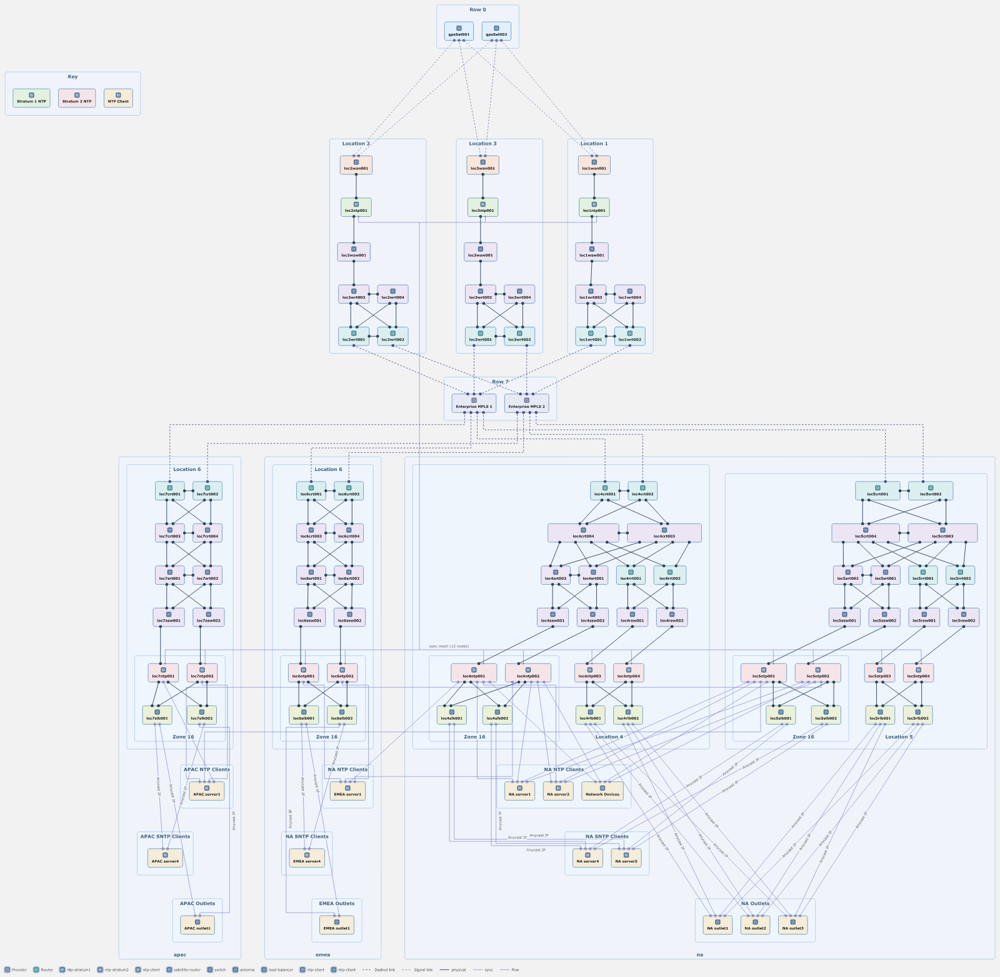

# portograph

[](https://github.com/simnv/portograph/actions/workflows/ci.yml)
[](https://www.npmjs.com/package/portograph)
[](LICENSE)

Write nodes, ports and links in YAML, and portograph draws the diagram as SVG or draw.io.

Each node has its ports on its sides, and each link attaches to a port. Each node is in a group,
and each group is on a tier, from top to bottom. A link between two facing ports is a
straight line when nothing is in its path. Other links turn at right angles in the gaps between
the tiers. The first target is network diagrams.



<details>
<summary>The YAML for this diagram (<code>docs/assets/example.yaml</code>)</summary>

```yaml
portograph: 2
groups:
  internet: { tier: 0, label: Internet }
  core: { tier: 1, label: Core }
  servers: { align: right, of: core, label: Servers }
  access: { tier: 2, label: Access }
nodes:
  isp-a: { group: internet, class: provider, label: ISP A, ports: [wan] }
  isp-b: { group: internet, class: provider, label: ISP B, ports: [wan] }
  core-1:
    group: core
    class: router
    description: 192.0.2.1
    ports: [{ name: wan, class: uplink }, te1, ge1, ge2]
  core-2:
    group: core
    class: router
    description: 192.0.2.2
    ports: [{ name: wan, class: uplink }, te1, te2, ge1, ge2]
  nms: { group: servers, class: Server, icon: server, label: NMS, description: 192.0.2.10, ports: [eth0] }
  acc-1: { group: access, class: Switch, icon: switch, label: Access 1, ports: [up1, up2] }
  acc-2: { group: access, class: Switch, icon: switch, label: Access 2, ports: [up1, up2] }
links:
  - [isp-a.wan, core-1.wan, { label: 1G }]
  - [isp-b.wan, core-2.wan, { label: 1G }]
  - [core-1.te1, core-2.te1]
  - [core-2.te2, nms.eth0, { class: dashed }]
  - [core-1.ge1, acc-1.up1]
  - [core-1.ge2, acc-2.up1]
  - [core-2.ge1, acc-1.up2]
  - [core-2.ge2, acc-2.up2]
```

</details>

## Install

portograph needs Node.js 22 or newer.

```sh
npm i -g portograph
```

To run it once without an install, use `npx portograph`.

## Quick start

Save the YAML above as `site.yaml`, then run:

```sh
portograph render site.yaml --output site.svg
```

This command writes three files: `site.svg`, `site.layout.json` and `site.score.json`. Open the
SVG in a browser. The layout JSON holds every position and path, and the score JSON holds the
quality checks.

For draw.io, set the format:

```sh
portograph render site.yaml --format drawio --output site.drawio
```

## CLI

```text
portograph <verb> [options] <file>
```

| Verb | Input | Output |
|---|---|---|
| `render` | YAML or layout JSON | SVG or draw.io, plus the layout JSON and the score JSON |
| `layout` | YAML | layout JSON |
| `score` | layout JSON | the gate results and the score, as JSON |
| `migrate` | YAML in the older d3-fd `diagram:` format | YAML in the current format (v2) |

Each command takes exactly one file. A file name of `-` reads stdin. Options can come before or
after the file.

| Option | Verbs | What it does |
|---|---|---|
| `--output <path>` | all | Writes the main output to this path. Without it, the main output goes to stdout. |
| `--diagnostics text\|json` | all | Sets the format of the messages on stderr. `json` writes one JSON object per line. |
| `--format svg\|drawio` | `render` | Sets the format of the main output. The default is `svg`. |
| `--layers routed,overlay` | `render` | Draws only these link families. |
| `--theme auto\|light\|dark\|print` | `render` | Sets the draw.io palette. The default `auto` puts light and dark in one file. |
| `--labels on-run\|measured` | `render` | Sets where draw.io puts link labels: on the link (default) or in the box that the layout calculated. |
| `--icons cisco19\|profile` | `render` | Sets the draw.io glyphs: the Cisco shapes of draw.io (default), or an image embedded in the file. |
| `--timings` | `layout`, `render`, `score` | Keeps the stage timings in the JSON. Without it, two runs on one input write the same bytes. |
| `--allow-gate-failures` | `render`, `score` | Reports a failed gate, but exits with 0. |
| `--force` | all | Lays out a document with more than 1,000 nodes. |
| `-h`, `--help` | | Shows the help. |
| `-V`, `--version` | | Shows the version. |

More examples:

```sh
cat site.yaml | portograph layout - > site.layout.json
portograph score site.layout.json
portograph render site.layout.json --layers routed --output routed.svg
portograph layout site.yaml --diagnostics json 2> diagnostics.jsonl
```

Each diagnostic gives the file, line and column of the YAML that it is about:

```text
portograph: error: UNKNOWN_KEY at site.yaml:7:5 ($.nodes.a.colour): Unknown key colour
```

Exit codes:

| Code | Meaning |
|---|---|
| 0 | The command succeeded. |
| 1 | A hard gate failed. The command still writes all its files. |
| 2 | An input error: usage, a file it cannot read, invalid YAML or JSON, or the node limit. |
| 3 | A processing failure: the 120-second command deadline, a missing worker file, or an internal error. |

Set `PORTOGRAPH_PROGRESS=1` to see the stage timings on stderr.

## Library

The package is ESM and CommonJS. It has types.

```js
import { parseWithDiagnostics, layout, score, render } from 'portograph';
import { createNodeElkFactory, createNodeRouteFactory } from 'portograph/node';

const parsed = parseWithDiagnostics(yaml);
if (!parsed.ok) throw new Error(JSON.stringify(parsed.diagnostics));
const model = await layout(parsed.document, {
  diagnostics: parsed.diagnostics,
  createElkAttempt: createNodeElkFactory(),
  createRouteAttempt: createNodeRouteFactory(),
});
const report = score(model);
const svg = render(model);
```

The package root exports these functions:

| Export | What it does |
|---|---|
| `parse(text)` | Parses YAML into a document. It throws `ParseError` on an error. |
| `parseWithDiagnostics(text)` | Parses YAML and returns `{ ok, document, diagnostics }`. It does not throw. |
| `layout(document, options)` | Lays out a document and returns the layout model. |
| `score(model)` | Returns the gate results and the score. |
| `render(model, options)` | Returns the SVG text. |
| `drawio(model, options)` | Returns the draw.io document. |
| `serializeLayoutModel(model)`, `restoreFinalLayout(json)` | Write and read the layout JSON. |
| `migrate(text)`, `migrateWithDiagnostics(text)` | Convert d3-fd YAML to the current format. |
| `createBudget(ms)` | Makes one time budget that all the solver calls of a layout share. |
| `createBrowserElkFactory()`, `createBrowserRouteFactory()` | Make the solver workers in a browser. |

The root also exports the error classes `ParseError`, `ResolveError`, `CommandDeadlineError`,
`ElkDeadlineError` and `RouteDeadlineError`, and the types. `portograph/node` exports
`createNodeElkFactory` and `createNodeRouteFactory`, which make the solver workers in Node.js.

`portograph/internal` exports the stage functions and the tables. It can change in any release.

In a browser, the page must serve four files over HTTP. Put `elkjs/lib/elk-worker.min.js` and
`portograph/dist/portograph-avoid-worker.mjs` beside the page. In the directory of that worker, serve
`libavoid-js/dist/index.js` as `libavoid.mjs`, and `libavoid-js/dist/libavoid.wasm` as it is. To use other locations, give the URLs to
`createBrowserElkFactory(url)` and `createBrowserRouteFactory({ workerUrl, moduleUrl, wasmUrl })`.
A bundler resolves the `elkjs/lib/elk-api.js` import of the ES build. Without a bundler, load
`elkjs/lib/elk-api.js` with a script tag before the UMD build `portograph/internal`
(`dist/portograph.umd.cjs`).

The library does not read the system fonts, so its output depends on the document only. The
`FONT_MISSING` check below is in the CLI only.

## The YAML format

[`docs/design/schema.md`](docs/design/schema.md) gives every key. The words that it uses, for
example tier, flank and bundle, are defined in [`GLOSSARY.md`](GLOSSARY.md) and
[`CONTEXT.md`](CONTEXT.md).

## Font: install Verdana

portograph measures all text with the glyph widths of Verdana, and the SVG and the draw.io file
ask for Verdana. The font list in the output is `Verdana, DejaVu Sans, sans-serif`. If a viewer
does not have Verdana, it uses a fallback font. That font has different widths, so the text can
be too wide for its box.

Verdana comes with macOS and Windows. On Linux, install the `ttf-mscorefonts-installer` package,
or copy the font files into `~/.local/share/fonts`. `portograph render` and `portograph layout`
write the warning `FONT_MISSING` when they do not find Verdana.

## How it works

The pipeline has one main rule. If placement can reserve a route, a size or a spacing, it does so
before the router starts. Placement sizes the lanes, the bars, the bundles and the gaps between
the tiers, so routing never moves a node to make room. The router draws only the links that the
region rules do not draw.

[ELK](https://github.com/kieler/elkjs) places the skeleton, and
[libavoid](https://github.com/Aksem/libavoid-js) routes the remaining links. The stages, in order,
are in [`docs/design/pipeline.md`](docs/design/pipeline.md). The gates and the score are in
[`docs/design/quality.md`](docs/design/quality.md), and the decisions are in
[`docs/adr/`](docs/adr/).

## Showcase

The NTP example sheet from drawthe.net, drawn by portograph:



## Contributing

Read [`CONTRIBUTING.md`](CONTRIBUTING.md) before you open a pull request. To report a security
problem, read [`SECURITY.md`](SECURITY.md).

## License

Apache-2.0. See [`LICENSE`](LICENSE).
